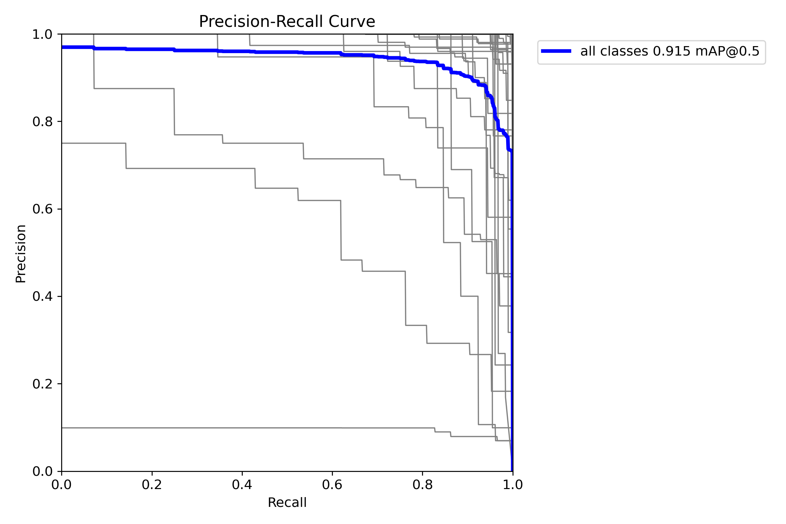

# 评估方法与真实指标

> 本文记录**线上实际使用的那份权重**（39 类，5.97 MB，SHA256 `F86C031B…`）的评估方式与结果。
> 仓库里 `runs/` 下的三次本地 CPU 训练是**流程验证**，指标很差、不具参考价值（见文末）。

## 一、为什么这个数据集的"检测"其实是"分类"

抽查 `dataset/labels/val/*.txt` 200 个文件、200 条标签：

```
框宽 中位数 = 1.0   框高 中位数 = 1.0     （归一化坐标，即整张图）
```

**每张图只有一个框，且框覆盖整幅图像。** 这是把"按文件夹分类"的数据集转成 YOLO 检测格式的典型做法。

由此产生两个必须知道的现象：

1. **`mAP50` 与 `mAP50-95` 数值完全相等** —— 因为所有框都是整图，任何 IoU 阈值下的 IoU 都相同，
   mAP50-95 平均的 10 个阈值给出同一个数。看到这个相等不要以为是 bug；
2. **这里的 mAP 实质上是"分类准确率 + 框回归到整图"的综合**，不能当成真实田间多目标检测精度。

## 二、复现命令

```bash
# 权重：线上优先加载的那份（与数据集包里的 best.pt 是同一文件）
python - <<'PY'
from ultralytics import YOLO
m = YOLO('path/to/newmodels/best.pt')
m.val(data='path/to/val39.yaml', split='val', imgsz=640, device='cpu', plots=True)
PY
```

> ⚠️ `val39.yaml` 里的 `path:` **必须是绝对路径**。
> Ultralytics 解析相对 `path` 时用的是它自己的 `datasets_dir`（默认在 ultralytics 安装目录下），
> **不是 yaml 所在目录** —— 我第一次跑就是这么失败的（报 `missing path`）。

## 三、实测结果（2026-11，val 全量 4528 张，CPU）

| 指标 | 值 |
|---|---|
| Precision | **0.8777** |
| Recall | **0.8959** |
| mAP50 | **0.9149** |
| mAP50-95 | 0.9149（原因见第一节） |
| 推理速度 | 131 ms/张（CPU，imgsz=640） |



## 四、这个数字该怎么看（重要）

| 偏见来源 | 说明 |
|---|---|
| **同源切分** | val 与 train 来自同一 Kaggle 数据集（PlantVillage 派生 + 增强），
画面是"单叶片、纯色背景"，真实田间的复杂背景、遮挡、多叶同框都不在里面 |
| **整图单框** | 如上，模型学到的是"这张图是哪种病"，不是"病斑在哪" |
| **增强数据** | 训练集含增强副本，val 也可能与增强源同图，指标偏乐观 |

**诚实的说法**：在**同分布测试集**上 39 类分类准确率约 **89–92%**；
**跨域（真实田间照片）会明显下降**，这需要另建测试集才能量化。

## 五、本地 CPU 三次训练为什么不用

| run | epoch | mAP50 | 说明 |
|---|---|---|---|
| `plant_disease_yolov11_cpu` | 6 | 0.075 | 中断 |
| `plant_disease_yolov11_cpu_optimized` | 44 | 0.053 | 中断，`imgsz=160` |
| `plant_disease_yolov11_win_cpu_optimized` | 135 | 0.013 | 中断，`imgsz=128` |

CPU + 低分辨率 + 受限于内存的 batch，39 类根本训不收敛。
**这三个 run 只证明流水线能跑通**，线上模型是在 Colab（GPU）上完整训练的。
